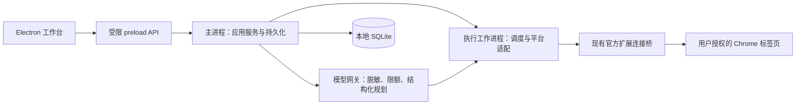

# 通用抢购助手技术与迁移方案

版本：1.5（补充模型供应商接入建议）  
更新日期：2026-10-15  
需求依据：[需求文档](./requirements.md)。Trellis 的 [任务 PRD](../.trellis/tasks/10-15-generic-purchase-desktop/prd.md) 汇总已确认范围；用户已授权开始实施，当前推进 M1。本文的推荐方案仍需逐项验证，已实现内容及证据见 [开发进展](./development-progress.md)。

## 1. 技术路线

复用现有 React、TypeScript、商城适配经验和官方 Playwright Extension 连接桥，迁到 Electron。成熟库负责构建、打包、状态机、校验、模型接口和数据迁移；项目代码集中在商品理解、平台适配和购买规则。

| 领域 | 推荐方案 | 复用目的与约束 |
| --- | --- | --- |
| 桌面运行时 | Electron | 本地工作台、通知、托盘、单实例、进程生命周期 |
| 开发构建 | electron-vite | 延续 React / Vite，分别构建 main、preload、renderer |
| 安装分发 | electron-builder 稳定版本 | Windows 安装包与资源打包，不自行编写安装器 |
| 界面 | 现有 React、TypeScript、lucide-react | 按功能拆现有界面，避免整体重写可复用部分 |
| 浏览器执行 | 固定版本 Playwright＋官方 Playwright Extension | 复用用户 Chrome 登录和现有接入逻辑 |
| 任务状态 | XState 稳定版 v5 | 显式描述等待、取消、人工接手、冷却、多平台进度及提交状态 |
| 契约校验 | Zod 稳定版 | 统一任务、IPC、模型输入输出与存储边界校验 |
| 模型接入 | AI SDK | 复用 OpenAI 兼容 Chat Completions 与 Anthropic 原生 Messages 的适配及结构化结果处理；用户自备 Key、端点及模型名 |
| 持久化 | SQLite，驱动优先验证 better-sqlite3 | 事务保存任务、数量与预算预留、多笔提交记录和事件，取代单份提交 JSON |
| 数据访问与迁移 | Drizzle 的稳定版本，验证后采用 | 使用已有迁移工具；不直接采用文档中的 RC 安装指令 |
| 检查与测试 | 保留 Node 测试及 Playwright fixtures，补 ESLint | 复用已有有效测试，增加关键状态和打包回归 |

选择 electron-vite＋electron-builder 的理由是延续已有 Vite 与 React。Electron Forge 的 Vite 插件在本次查阅时仍标记 experimental；不把它作为此项目优先方案，也不同时引入两套打包系统。

选型时固定兼容的稳定版本并提交锁文件。官网“latest”可能指预览文档，不应直接等同于可用于本项目的稳定依赖。

首版已确定面向 Windows 自用和普通 Chrome。建议采用 electron-builder 的 Windows NSIS 安装包，随包包含运行时、应用和必需依赖；用户只需安装 Chrome 与官方扩展，无需单独安装 Node 或测试用 Chromium。公开分发渠道、自动更新服务与其他系统支持不列为首版必交付项。

## 2. 进程职责



- Renderer 仅展示任务和发送有类型的业务命令，不获得 Node、数据库、密钥或任意浏览器控制接口。
- Preload 仅暴露创建任务、准备、启动、停止、接手、连接等有限能力；校验输入、调用来源和事件订阅生命周期。
- Main 管理应用生命周期、用户数据、密钥和任务服务；自动化放在可取消的工作进程，避免阻塞界面。
- 执行进程通过存储端口请求主进程提交事务；所有购买副作用必须等待提交意图持久化的确认。
- 复用 Electron IPC 与 MessagePort，不自行开发 RPC 服务。现有 Express HTTP 入口可在迁移阶段使用，完成后删除桌面不再需要的对外接口。
- 使用 utilityProcess 等成熟进程机制，但现有扩展桥对子进程环境有依赖，最终进程组织须通过打包验证再确定。

默认建议单项目结构，继续使用 npm 和锁文件；当前规模不强制引入 monorepo、微服务或新的包管理器。

## 3. 建议目录

遵循 electron-vite 的 main / preload / renderer 布局，主进程内部按业务与基础设施拆分。目录与代码规则统一遵守 [工程与代码规范](./engineering-standards.md)。

```text
src/
  main/
    app/                    # 窗口、托盘、单实例、退出和 worker 生命周期
    ipc/                    # 受限命令、事件和 sender 校验
    domain/                 # 通用商品、任务、约束与订单结果
    application/            # 创建、准备、启动、停止、接手等用例
    automation/
      machines/             # 任务与候选的 XState 状态机
      scheduling/           # 开售时间、共享节流、刷新与取消
      orders/               # 数量/预算预留、账户互斥、提交意图与结果
      adapters/
        apple/
        taobao/
        tmall/
        jd/
        douyin/
    infrastructure/
      browser/              # 官方扩展桥、标签页授权和登录读取
      ai/                   # AI SDK、脱敏、工具约束和用量限制
      storage/              # SQLite、repositories 与迁移入口
      notifications/
    workers/
  preload/
  renderer/
    app/                    # 页面入口与整体布局
    features/
      tasks/
      connections/
      models/
      history/
    components/             # 真正跨功能复用的界面组件
    styles/                 # 变量、基础样式；功能样式就近放置
  shared/
    contracts/              # IPC、模型和持久化边界 schema
    types/
resources/                  # 随安装包分发的执行资源
config/                     # 工具配置与迁移检查基线
scripts/                    # 开发与检查入口
migrations/
tests/
  unit/
  integration/
  fixtures/
  packaging/
docs/
electron.vite.config.ts
electron-builder.yml
package.json
```

目录是职责边界，不要求每一项立刻建空文件夹。平台适配器可共享页面读取工具，但不再以 AppleBrowser 作为其他商城的业务父类。

Domain 不依赖 Electron、Playwright、React 或模型 SDK。应用用例通过接口使用存储、页面、模型与时钟；基础设施实现接口，使规则可以离线验证。

## 4. 关键契约

### 4.1 平台适配器

统一表达平台元数据、URL 规范化、商品读取、规格识别与选择、准备检查、购买入口、订单读取、提交和结果识别。能力声明按“可读取 / 可准备 / 可结账 / 可提交”返回，不假设每种商品都具备全部能力。

淘宝与天猫可共享页面解析工具和访问组，同时保留独立平台身份。适配器只处理页面动作，跨任务资源锁和订单约束由上层执行器统一管理。

首版通过应用内注册表装配适配器。内部插件接口应允许以后增加平台；暂不建设第三方插件市场、任意脚本加载或自行实现沙箱。订单类型也是能力检查的一部分，复杂订单按已确认要求返回人工接手原因，不能落到普通全款提交逻辑。

### 4.2 执行计划

AI 输出包括平台和页面身份、目标规格、建议定位器、有限操作、前置条件、核对证据和不确定项。计划须携带版本、创建时间、任务配置摘要及适配器版本。

页面或商品身份变化、规格调整、定位不唯一、预算变化、模型输出不完整时使计划失效。实际点击前仍读取当前页面；定位器匹配不代表订单核对通过。

模型网关按已确认的 OpenAI 兼容 Chat Completions 与 Anthropic 原生 Messages 分别适配，复用成熟 SDK，不自行实现协议栈。两类接口均须完成多份配置保存、切换、逐个连接测试、文本页面分析与本地 schema 计划校验；原生工具调用、视觉输入或供应商专有结构化输出不是首版最低能力，不因 SDK 支持而扩展产品范围。

首版供应商清单新增 Gemini、DeepSeek、Kimi、豆包（火山方舟）。技术建议为四家复用 Chat Completions 适配层，各自保存供应商身份、端点、密钥引用、模型标识与已检测能力；共用协议不代表参数或模型能力完全相同。Anthropic 继续使用已确认的原生 Messages 适配。Gemini 原生 API 为另一种技术路径，不因供应商清单增加而默认扩展原生功能；四家最低能力仍须分别验证。官方依据见 PRD 的 R07。

### 4.3 数量、订单与资源

已确认每个任务可选择跨平台合计配额，或每个平台独立配额。一个候选成功不会默认取消整个任务。任务状态机汇总各平台进度，候选状态机管理各自执行；达到对应目标才停止该范围的新增购买。

多个不同商品任务可并行，各有任务协调器；全应用资源管理器统一处理标签页占用、账户结账互斥与访问组限额。任意任务不得独占不相关平台的执行资格，也不能因为本任务的局部锁忽略另一个任务占用的浏览器资源。

建议表包括 tasks、purchase_quotas、candidates、runs、events、purchase_intents、submission_attempts、orders、access_restrictions、schema_migrations；模型密钥引用与任务数据分开。

跨平台合计模式的候选共享任务配额；分平台模式的同平台候选共享该平台配额。商品件数与订单笔数分别保存，单笔数量由本次意图明确指定。有效订单号加商品数量核对通过后累计已下单件数，待支付订单也计入。订单记录关联购买意图，并以平台和订单号设置唯一约束，反复读取不得重复计数。

减量设置按任务保存且默认关闭。关闭时，单笔数量无法满足则暂停相应候选；开启后才允许在剩余额度与页面可购数量内减少本次数量并分多笔完成，不能改变规格、目标、预算或平台限购。每次意图保留实际确定的数量，后续订单核对使用该数量。

通过数据库事务执行额度检查与预留：已确认件数＋未决占用件数＋执行预留件数不得超过对应目标。数量、预算和提交意图必须关联，防止多个 worker 同时读取剩余额度后超额购买。金额以整数分保存；预算按已确认的每件最高价＋任务总预算核对。所有平台累计优惠后最终应付总额，包含运费且不重复计入，后续退款、返现不预先抵扣；已下单（含待支付）、未决和执行预留金额受共同的任务预算约束。

结账资源按浏览器账户上下文管理。同一任务可在不同平台同时购买，不设置固定的全任务唯一赢家。平台 Cookie 不用于提取账号凭证；不能可靠识别账户时，同一资料和同一站点的结账按保守共享资源串行处理。

每次提交绑定独立 purchase intent，以事务保存后再允许页面点击，结果写为 confirmed 或 unknown。相同意图不得重复触发，不同意图只有在配额、预算与资源允许时执行。数据库能够约束本地执行记录，不能保证商城的网络操作具备 exactly-once 语义；不明结果必须保留核对状态和额度占用。

明确从未生成订单且无订单副作用的失败才可释放预留。某平台结果未知时，是否阻塞其他平台由共享配额、总预算和账户资源决定，不能一律全局停止，也不能一律继续。用户核对后记录处置与证据。已确认的有效订单后来取消、关闭或支付超时，保留原任务进度与历史，不自动释放数量或预算用于补买；需要再买时由用户另建购买目标。

多次重试、任务复制和应用重启均不能绕过未决提交。旧版本只有一份全应用记录，迁移遇到无法归属的记录时先保留全局阻塞，核对后再细化。

任务累计量由持久化订单和未决意图计算，不能仅保存在单次运行的内存状态。继续执行会创建新 run ID，但继承任务剩余配额和预算；新一批购买通过新任务表达，不复用或清零旧订单记录。

提交方式在创建任务时必选且不预选，契约不能用默认布尔值替用户选择。已选择的自动提交模式通过本地核对后可提交，无需逐单确认；人工确认模式在提交前等待用户确认。执行器从任务记录读取模式，模型不得修改。

## 5. 安全与隐私实现

- Electron 启用 contextIsolation、sandbox，关闭 renderer 的 nodeIntegration；限制导航、新窗口及外部 URL 协议。
- 商城页面留在用户浏览器，不加载到具备本地权限的窗口中。
- IPC 验证来源、schema 与运行阶段；renderer 不能直接请求任意 Playwright 操作。
- 模型密钥在主进程借助 safeStorage 保护，按所选 Electron 稳定版本使用相应 API；Windows 依赖 DPAPI，不宣称可抵御同一用户下的所有程序。
- 配置密钥时界面只负责提交，保存后清空输入；主进程仅返回配置状态和脱敏标识，不提供已保存密钥的明文读取接口。
- 对外模型数据先脱敏、限量和裁剪；完整页面、地址、支付信息与会话凭证不自动上传。
- 对模型返回工具调用设置白名单、次数、超时和取消；页面中的文本不能修改任务权限。
- 日志只保存必要的脱敏证据，导出默认移除个人信息、密钥与跟踪参数。

## 6. 必须先验证的集成点

1. Electron 打包后，现有扩展桥能否启动、取消授权等待并连接 Windows 命名管道。
2. `playwright-core/lib/coreBundle` 内部接口与固定版本的兼容性，以及断开后保留普通 Chrome 的语义。
3. ASAR 内外资源路径、worker 入口、Playwright 依赖和 SQLite 原生模块的装载。需要执行的文件及原生模块按官方规则解包，不能照搬普通 Node 启动方式。
4. SQLite 驱动与目标 Electron ABI、安装包的兼容性；Drizzle 稳定版本的 schema 与迁移支持。
5. 两类已确认接口通过所选成熟 SDK 对接后，用户配置的端点能否完成文本页面分析和本地结构化计划校验，以及超时取消、错误处理和可用用量信息；接口连通不等同于模型能力达标。视觉、原生工具调用及其他协议不属于首版验证要求。
6. 冷启动、重启、崩溃恢复、休眠唤醒、退出与 worker 结束时的订单锁和定时器行为。

以上均属于技术验证，不能在需求文档中描述为已经解决。验证优先使用临时数据、离线页面与无购买副作用的扩展连接。

## 7. 迁移顺序与退出条件

| 阶段 | 交付内容 | 完成条件 |
| --- | --- | --- |
| M0 需求交接（planning） | 通用模型、任务规则、AI 分工及首版边界 | Trellis task／PRD 已完成；Q01–Q05 已确认，无剩余待用户确定的需求项，等待后续实施指令 |
| M1 技术验证 | Electron 空壳＋官方扩展桥＋最小安装包＋存储验证 | Windows 安装后接入、读取和断开均通过 |
| M2 通用内核 | 商品与任务契约、两种配额、状态机、多笔事务提交记录、旧数据迁移 | 离线订单约束、取消、并发配额和恢复测试通过 |
| M3 桌面工作台 | 任务、连接与登录、历史、通知和托盘 | 清晰显示真实状态，原大文件完成职责拆分 |
| M4 平台适配 | 五平台模块化、商品准备及能力声明 | 各平台离线回归及真实只读核对有记录 |
| M5 模型协助 | 两类模型接口、四家供应商配置、文本页面分析、结构化准备、脱敏与异常处理 | 两类协议和 Gemini、DeepSeek、Kimi、豆包分别通过最低能力验收，模型不可用与越权输出均能正确处理 |
| M6 迁移交付 | 删除 managed 路径、旧 HTTP 启动入口和专属商品硬编码 | 迁移、打包、完整必要回归与代码行数检查通过 |

先拆业务与连接边界，再移除旧代码。删除的是独立浏览器执行入口，不删除用户原资料。各阶段保留可运行和可回退的节点；不对运行中的旧服务做混合迁移。

## 8. 文件拆分与验证

2026-10-15 以物理行计数，当前超限文件为：

| 文件 | 物理行数 | 拆分方向 |
| --- | ---: | --- |
| src/App.tsx | 1603 | 页面、任务功能、连接功能、状态 hooks 与弹窗 |
| src/styles.css | 2785 | 全局变量、布局和各功能局部样式 |
| server/browser.ts | 574 | 扩展接入、页面工具、平台适配与订单读取 |
| server/runner.ts | 514 | 用例、状态机、候选调度、订单资源与接手 |

已加入 `npm run check:lines`，统一统计手写代码物理行。当前 4 个大文件保存在 `config/file-size-baseline.json`，允许现有大小但禁止增长；拆分后删除相应基线。`npm run check:lines:strict` 按 400 行检查全部文件，作为迁移完成门槛。后续 ESLint 接入时同步采用 max-lines 规则，空行和注释均计入，不能靠拆成缺乏职责的碎片达标。

保留现有有效测试，优先补通用规格、两种数量模式、多平台并发预留、一笔多件计数、任务与账户互斥、未决提交重启、AI 计划失效、低预算和错误 SKU 等关键场景。打包验证必须覆盖实际安装包；开发模式启动成功不能替代安装包验证。

## 9. 官方资料与选型依据

以下于 2026-10-15 直接读取官方文档核对；具体依赖版本在实现前再次固定和验证。

- [electron-vite 指南](https://electron-vite.org/guide/)：main / preload / renderer 分别构建，可复用 React / TypeScript。
- [electron-vite 分发说明](https://electron-vite.org/guide/distribution)：electron-builder 配置、ASAR 与原生资源注意事项。
- [electron-builder](https://www.electron.build/)：桌面应用打包方案；查阅时首页为下一版本文档，实施须切换稳定版本。
- [Electron Forge Vite 插件](https://www.electronforge.io/config/plugins/vite)：官方仍标记 experimental，作为候选取舍依据。
- [Electron 安全指南](https://www.electronjs.org/docs/latest/tutorial/security)：进程隔离、受限权限与 IPC 校验。
- [Electron safeStorage](https://www.electronjs.org/docs/latest/api/safe-storage)：本地密钥保护与平台差异。
- [Electron utilityProcess](https://www.electronjs.org/docs/latest/api/utility-process)：Node 工作进程和消息端口。
- [Playwright Extension](https://chromewebstore.google.com/detail/playwright-extension/mmlmfjhmonkocbjadbfplnigmagldckm)：现有普通 Chrome 接入方式；本项目桥仍有内部 API 依赖。
- [XState](https://stately.ai/docs/xstate)：状态机与 actors；v6 为 alpha，建议验证稳定 v5。
- [Zod](https://zod.dev/)：稳定的 TypeScript schema 校验和类型推导。
- [AI SDK](https://ai-sdk.dev/docs/introduction)：多供应商接口、结构化结果与工具调用。
- [Drizzle SQLite](https://orm.drizzle.team/docs/get-started-sqlite)：SQLite 驱动接入；查阅时含 RC 安装示例，选型不能直接照抄。
